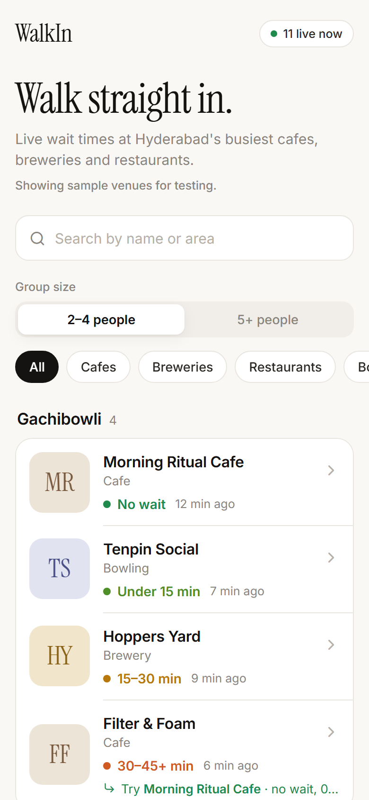
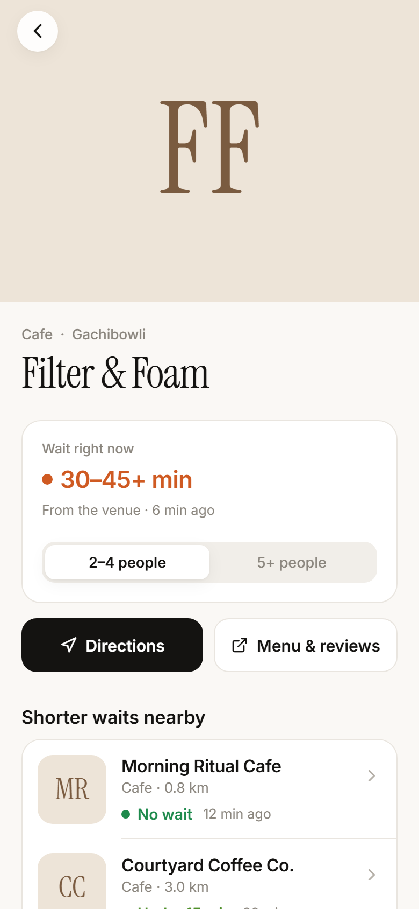
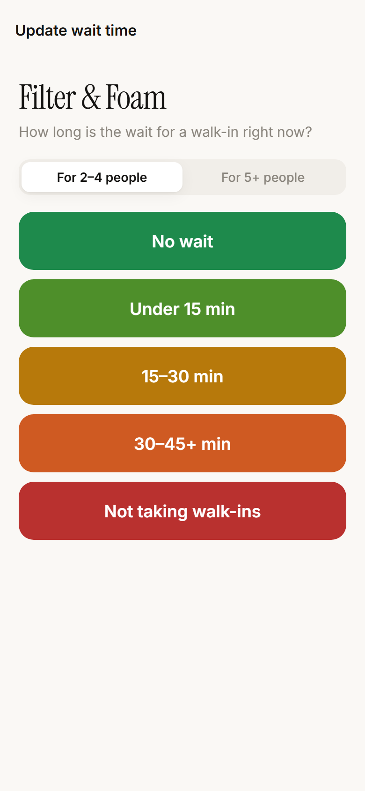

# WalkIn

**Live wait times for Hyderabad's busiest cafes, breweries and restaurants — so you know if you can walk straight in before you leave home.**

Weekend evenings at popular places in Hyderabad mean long waits, and you usually only find out once you're at the door. WalkIn shows the current wait at each venue, for your group size, and points you to a nearby place with a shorter wait when one is packed.

Built with **React Native (Expo)**, **TypeScript** and **Supabase (PostgreSQL)** — one codebase for iOS, Android and the web.

<p align="center">
  
  &nbsp;
  
  &nbsp;
  
</p>
<p align="center"><sub>Venue list · Venue page · Staff update page (screenshots use sample data)</sub></p>

## Features

- **Live waits by group size.** Separate waits for 2–4 and 5+ people, because a table for six is a very different wait from a table for two.
- **Never shows stale data as live.** Every update shows who posted it and when, and expires after 45 minutes.
- **Shorter waits nearby.** When a place is busy, the app suggests a venue of the same type within 6 km with a shorter live wait, using haversine distance.
- **One-tap staff updates, no login.** Each venue gets a private link (meant to be a QR code at the host stand). Staff tap one button to post the current wait.
- **Nothing to sign up for.** People checking waits don't need an account.
- **Search and filters** by name, area, category and group size, plus pull to refresh. Data refreshes every minute and whenever you come back to the screen.
- **Directions and Menu & reviews** buttons that open the venue in Google Maps.

## How it works

```
 Staff phone                    Supabase (PostgreSQL)                   WalkIn app
 /update/<token>  ──RPC──▶  submit_venue_status(token, …)   ◀──select──  venue list
                            checks the token, inserts a     (read-only)   venue page
                            status_report                                  refresh every 60s
```

**Security model.** Staff never get accounts. Instead:

- **Row Level Security** is on for every table. The public app can only *read* venues and status reports. Nobody can write to the tables directly.
- Writes go through **`SECURITY DEFINER` Postgres functions** (`submit_venue_status`, `venue_for_token`). They only accept a valid venue token, and check constraints on the table reject any unknown wait level or group size.
- A **trigger** gives each new venue a random secret token automatically, stored in a table the public can't read.

So the public API key that ships inside the app can read wait times but can't fake them.

**Data model.**

| Table | Holds |
|---|---|
| `venues` | name, area, category, coordinates, Google Maps link, price level, photo |
| `venue_tokens` | one secret staff token per venue (no public access) |
| `status_reports` | venue, group size, wait level, source (`venue` / `community` / `estimate`), time |

## Tech stack

- **App:** Expo SDK 58, React Native 0.88, React 19, TypeScript, Expo Router (file-based, typed routes), expo-image
- **Backend:** Supabase: PostgreSQL, RLS, RPC functions, triggers
- **Design:** custom component set (status line, segmented control, chips, venue rows), Inter + Instrument Serif fonts, Feather icons
- **Tooling:** ESLint, `tsc --noEmit`

## Run it locally

```bash
npm install
npm run web      # opens in the browser
npm start        # scan the QR code with Expo Go to run it on your phone
```

With no `.env`, the app runs on **built-in sample data**, so no keys are needed to try it. Demo staff links look like `/update/demo-c1` (`demo-` plus a venue id from `src/lib/sampleData.ts`).

### Connect your own Supabase project

1. Create a free project at [supabase.com](https://supabase.com).
2. In the SQL Editor, run `supabase/schema.sql`, then optionally `supabase/seed_venues.sql` to add 13 real Hyderabad venues.
3. Copy `.env.example` to `.env` and fill in the project URL and publishable key (Project Settings → API).
4. Restart `npm run web`.

Get each venue's private staff link with:

```sql
select v.name, t.token from venues v join venue_tokens t on t.venue_id = v.id order by v.name;
```

The staff page is then `/update/<token>`.

## Project structure

```
src/app/            screens (Expo Router: each file is a route)
  index.tsx         venue list
  venue/[id].tsx    venue page
  update/[token].tsx  staff update page
src/components/     design system (ui.tsx) and VenueRow
src/lib/status.ts   wait levels, freshness, distance, nearby alternatives
src/lib/api.ts      data access (Supabase, or sample data when not configured)
supabase/           schema, seed data, migrations
```

## Status and roadmap

The first working version is done, with 13 real venues across Jubilee Hills, Banjara Hills and Gachibowli. Next:

- [ ] Public web deployment
- [ ] "I'm here, what's the wait?" reports from visitors
- [ ] Printable QR codes for staff links
- [ ] Pilot with a few venues and friends at weekend peak hours
- [ ] Venue photos
- [ ] Wait predictions from past data when there's no live update
- [ ] iOS and Android builds
